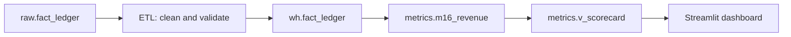
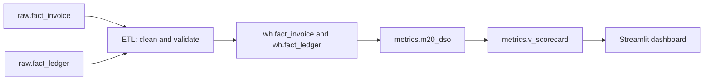
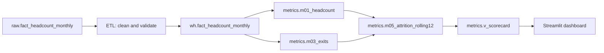
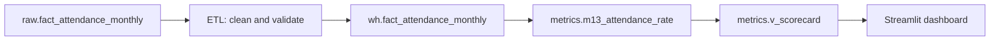
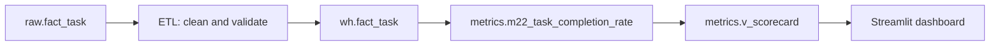

# Metric lineage

Each number travels: raw table, ETL, warehouse table, metric view, scorecard view, dashboard.

## M16 Revenue

## M20 Days sales outstanding

## M05 Attrition, rolling 12 months

## M13 Attendance rate

## M22 Task completion rate

