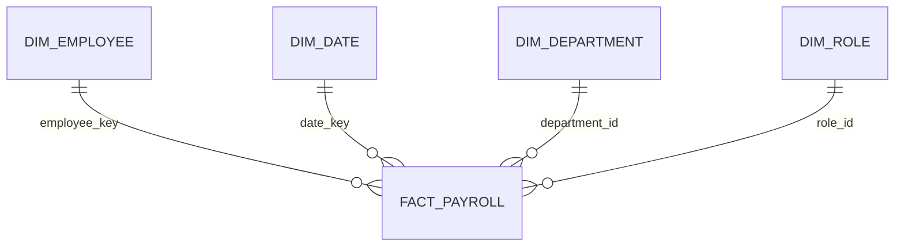
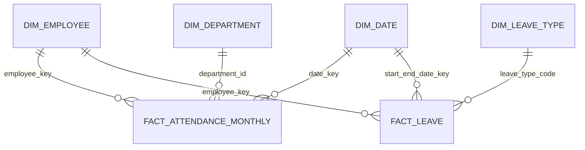
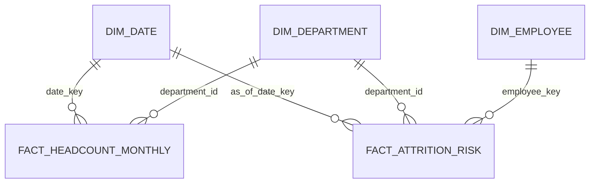
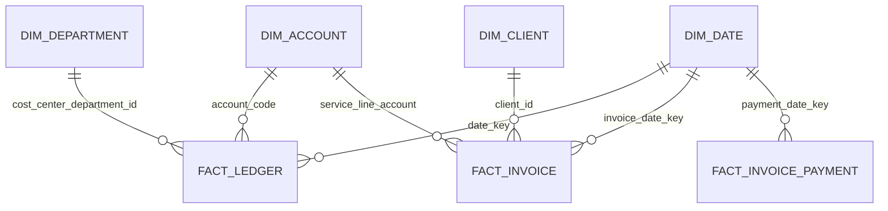
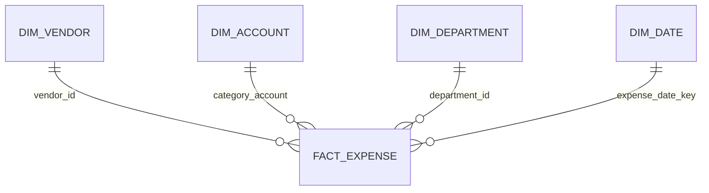
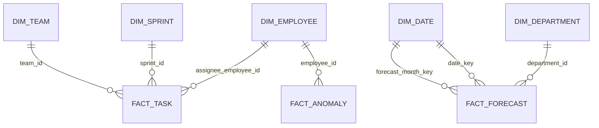

# PulseIQ star schema

Grain, keys and joins come from the dataset README and were checked against the real warehouse columns. `dim_employee` is SCD Type 2 (one row per employee version), so facts join on `employee_key`.

## 1a. Payroll star

## 1b. Attendance and leave stars

## 1c. Headcount and attrition risk stars

## 2a. Ledger, invoice and payment stars

## 2b. Expense star

## 2c. Task, anomaly and forecast stars

