# PulseIQ Analytics

PulseIQ is a trusted people-analytics warehouse and dashboard (part of Aura Workforce). 
It loads the raw HR and finance exports through a repeatable pipeline that validates every column
against its data contract, builds a star-schema warehouse, runs a
data-quality gate on every load, and serves governed metrics to a workforce
and headcount dashboard. It is for HR leaders and analysts who need
workforce numbers they can trust.

**Author:** Shaikh Naved, Data Analysts track. Tasks PQ-01 to PQ-05 (Phase 1).

## Live demo
The dashboard runs locally (see "Run it locally" below), then opens at
http://localhost:8501. Screenshots of the dashboard, the data-quality report
and the pipeline run are in the report PDF and in the `docs/` folder.
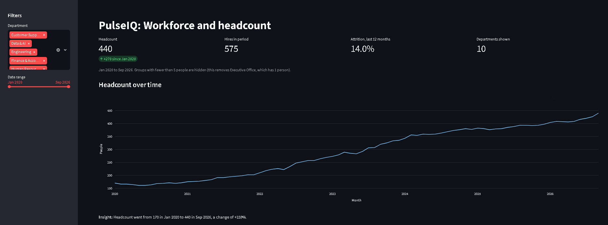
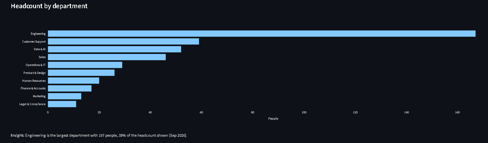
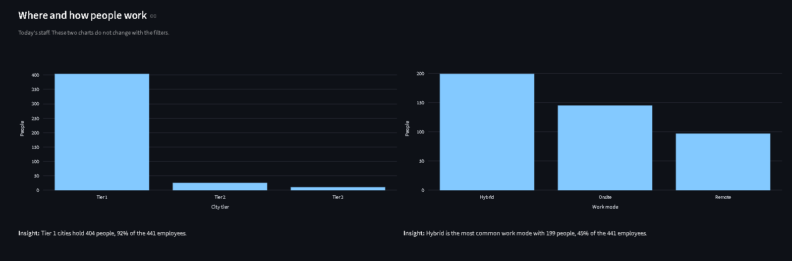

## Features
- **ETL with data contracts (PQ-01):** validates 29 tables column by column.
  Rows that break a contract go to a quarantine table with the reason.
- **Star-schema warehouse (PQ-02):** 23 dimension and fact tables. Facts join
  history through `employee_key` (slowly changing dimension).
- **Data-quality gatekeeper (PQ-03):** 14 checks run on every load and write a
  report. The gate blocks when a critical check fails.
- **Governed metric layer (PQ-04):** official metrics as reusable SQL views
  with the minimum-group-size privacy rule.
-- **Workforce and headcount dashboard (PQ-05):** KPI tiles, headcount trend, headcount by department, city tier and work mode, with department and date filters.
## Tech stack
Python 3.12, pandas, pandera, DuckDB, SQL, Streamlit, Git/GitHub.

## Run it locally
1. Clone the repository: `git clone https://github.com/shaikhnaved-coder/pulseiq.git` then `cd pulseiq`
2. Create a virtual environment: `python -m venv venv`
3. Activate it (Windows PowerShell): `venv\Scripts\Activate.ps1`
4. Install the packages: `pip install -r requirements.txt`
5. Download the dataset from https://docs.google.com/spreadsheets/d/1tbSD2iIPvjEmTrHYHPwDamDIhxramBvM and place it in `03_Data/`
6. Load the raw data: `cd 05_Starter` then `python load_to_duckdb.py`
7. Run the ETL (still in `05_Starter`): `python etl.py`, then `cd ..`
8. Build the warehouse: `python src\warehouse.py`
9. Run the data-quality gate: `python src\gatekeeper.py`
10. Create the metric views: `python src\run_sql.py`
11. Start the dashboard: `streamlit run app\app.py` (opens at http://localhost:8501)

## Architecture

Pipeline:

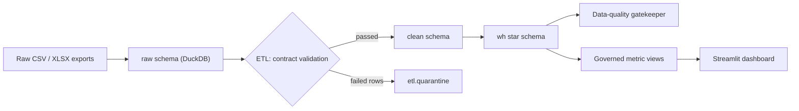

Star schema (payroll, attendance and leave). Facts join to `dim_employee`
through `employee_key` (slowly changing dimension):

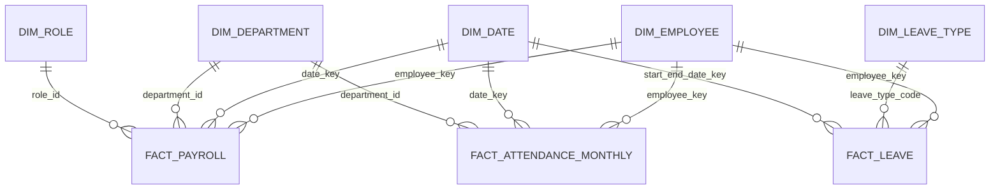

The full diagrams for every fact table are in [docs/star_schema.md](docs/star_schema.md).


## How I verified it works
- **Idempotent ETL:** two runs gave the same result: 29 tables, 62,770 rows in,
  62,737 passed, 33 quarantined, fingerprint `5249d226e200`. In = passed +
  quarantined for every table.
- **Quarantine:** attendance 4, attrition risk 5, payroll 4, task 20.
- **Warehouse reconciliation:** for the 23 warehouse tables,
  README = raw = quarantined + passed = clean = warehouse
  (61,904 rows, nothing lost). The other 6 tables (contracts, dictionaries,
  targets, payroll budget) are validated but are not warehouse tables.
- **Orphan check:** 0 broken keys on the employee, department, role, date,
  account, client, vendor, team and sprint keys. The rest are expected: 5,688
  ledger rows have no cost centre, 12 forecast rows use `ALL`, and 36 forecast
  rows fall after the end of the date table.
- **Data-quality gate:** 14 checks, 8 pass and 6 fail on the planted issues
  (2 critical), so the gate reports BLOCKED. This is correct for this dataset.
  Results were identical on repeat runs. `src\test_gatekeeper.py` runs 13
  tests on the checks themselves.
- **Planted issues:** `src\verifyplanted_issues.py` finds all 11 known issues
  (DQ-01 to DQ-11) in the data.

## Limitations and what I would do next
- Phase 1 only (PQ-01 to PQ-05). Later tasks are not built yet.
- The dashboard runs locally and is not deployed.
- DQ-C14 (minimum group size) flags 18 groups, and the dashboard hides small groups.
- No scheduler: the pipeline runs by hand.
- Next: containerise the pipeline, add CI to run the tests on every push,
  deploy the dashboard, and add the next dashboards.


  ## Attendance and leave findings 
  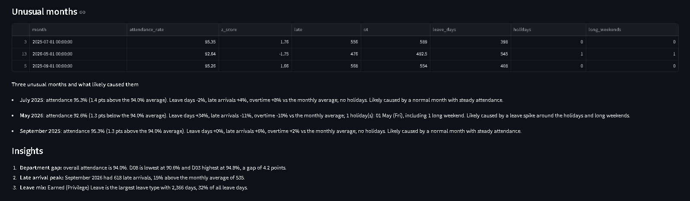

- Department gap: overall attendance is 94.0%. D08 is lowest at 90.6% and D03 highest at 94.8%, a gap of 4.2 points.
- Late arrival peak: September 2026 had 618 late arrivals, 15% above the monthly average of 535.
- Leave mix: Earned (Privilege) Leave is the largest leave type with 2,366 days, 32% of all leave days.

# Three unusual months and what likely caused them

- July 2025: attendance 95.3% (1.4 pts above the 94.0% average). Leave days -2%, late arrivals +4%, overtime +8% vs the monthly average; no holidays. Likely caused by a normal month with steady attendance.
- May 2026: attendance 92.6% (1.3 pts below the 94.0% average). Leave days +34%, late arrivals -11%, overtime -10% vs the monthly average; 1 holiday(s): 01 May (Fri), including 1 long weekend. Likely caused by a leave spike around the holidays and long weekends.
- September 2025: attendance 95.3% (1.3 pts above the 94.0% average). Leave days +0%, late arrivals +6%, overtime +2% vs the monthly average; no holidays. Likely caused by a normal month with steady attendance.

## Attrition analytics

### Actual exits
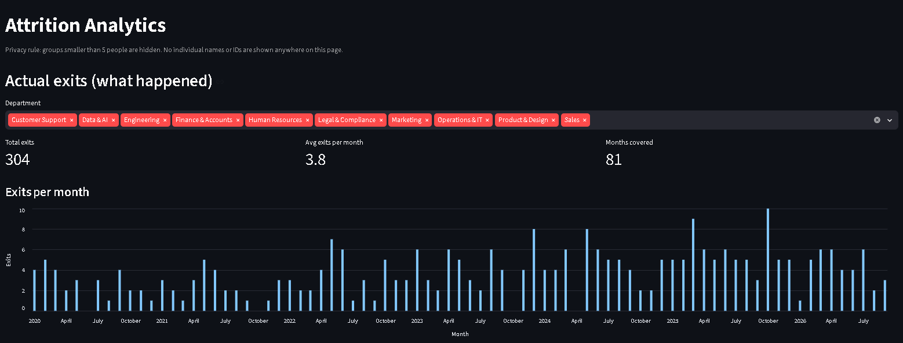
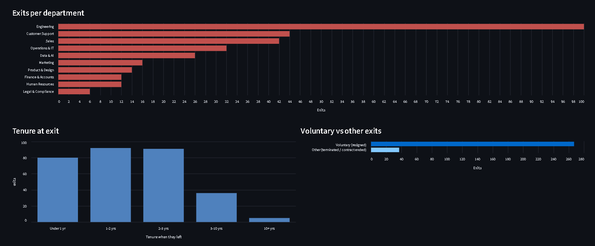

### Predicted, not certain
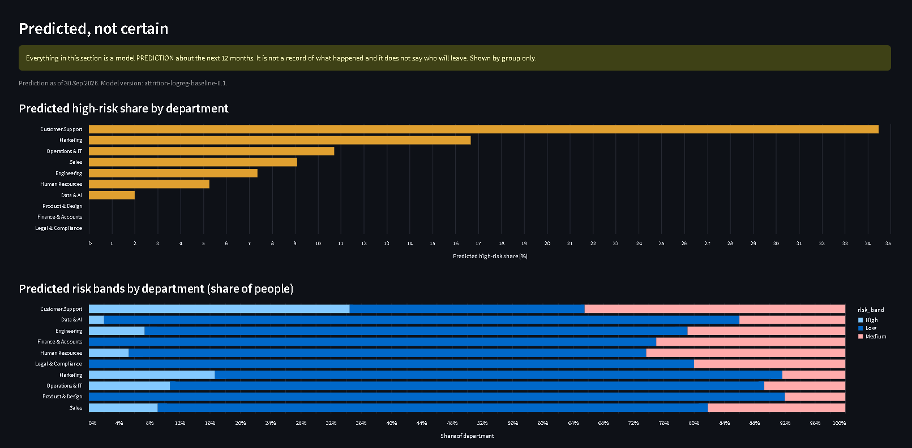

## Team productivity 
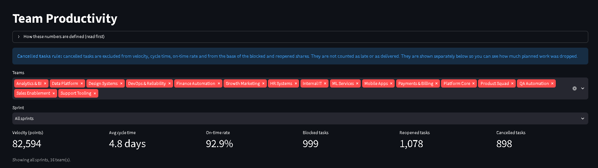

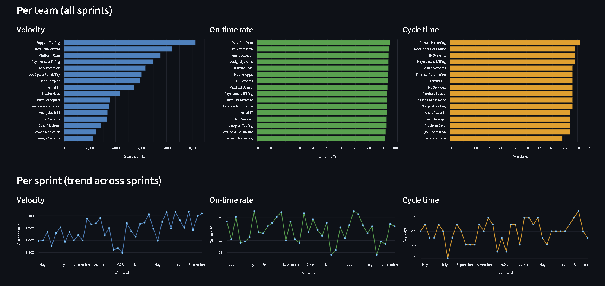

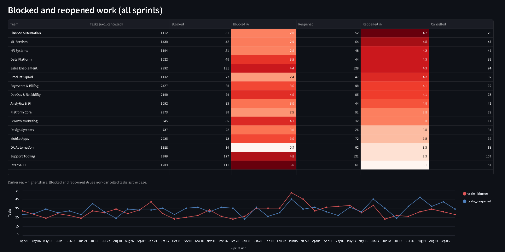

**Rules:** velocity = story points of Done tasks; cycle time = days from started to completed, Done tasks only; on-time = Done tasks marked completed_on_time = Y divided by Done tasks. Cancelled tasks are excluded from all three and shown separately.

**Verified by hand:** Support Tooling and Design Systems were recalculated from the raw task table and matched the page exactly (Support Tooling: 10,274 points, 4.8 days, 92.3% on time; Design Systems: 2,257 points, 4.8 days, 93.6% on time). For sprint SP-38 I also checked the sums in Excel: [Support Tooling Excel velocity] and [Design Systems Excel velocity], matching the page.

**Findings:** 
-- 3 findings about team health--
- Delivery reliability: Growth Marketing has the lowest on-time rate at 91.3%, 1.6 points below the overall 92.9%.
- Slowest flow: Growth Marketing has the longest cycle time at 5.1 days against 4.8 days overall.
- Rework and blockers: Finance Automation reopens the most work: 4.7% of its tasks (52) against 3.9% overall. Internal IT has the    highest share of blocked work: 5.6% of its tasks (111 tasks) against 3.6% overall.

## Payroll cost and reconciliation 
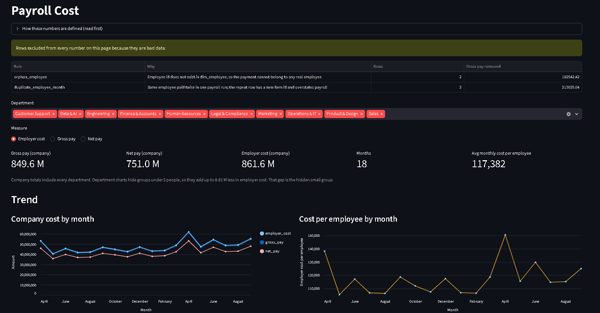

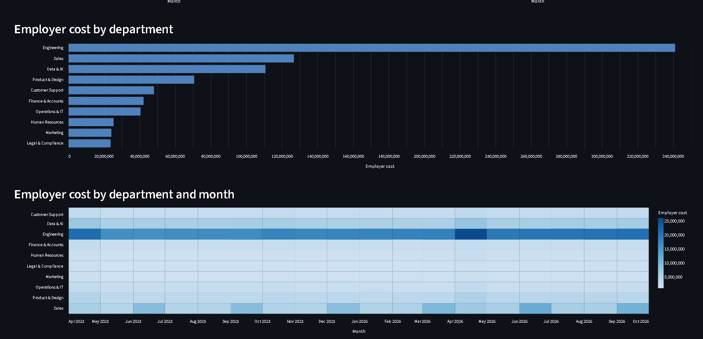

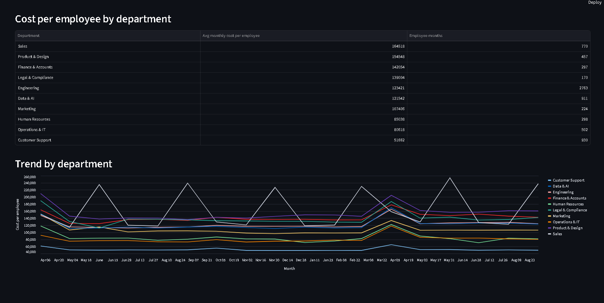

**Excluded rows (4):** two exact duplicates of an existing employee-month (PI-X0001, PI-X0002) and two payments to employee IDs that do not exist (PI-X0003, PI-X0004). Together they overstate gross pay by 405,567.46. I excluded them because a duplicate pays the same person twice and a payment to a non-existent employee cannot be real. Full list: docs/payroll_excluded_rows.csv.

**Reconciliation:** the raw payroll total minus these 4 rows equals the warehouse total (gross 849,626,960.27, net 751,018,306.69, employer cost 861,586,392.42). The amounts removed match the Task 3 data-quality key exactly. Full table: docs/payroll_reconciliation.csv.

**PQ-09 answer key:** my totals match the answer key for all 18 months and in total (gross 849,626,960.27, net 751,018,306.69, employer cost 861,586,392.42), with a difference of 0.00. The employees paid each month also match. The key shows no payroll-versus-ledger difference in any month, so there is no remaining difference to document.

**Remaining difference:** June 2026 ledger salary expense is 18,450.00 above the payroll run (DQ-04). This is a ledger posting issue, not a payroll table issue.

**Privacy:** the page shows only totals and averages. Groups under 5 people are hidden, including the one-person Executive Office, so department charts add up to less than the company total.

##  Budget versus actual and KPI targets :

**Objective:** compare payroll to budget and KPIs to targets, with variance and traffic lights.
**Page:** `app/pages/Budget_vs_Actual.py` (run with `streamlit run app/app.py`, then open Budget vs Actual in the sidebar).

### What was built
- `budget_payroll_dept_month` and `kpi_targets` were already loaded in the `clean` schema by the ETL, so they were used from there.
- Three DuckDB views in the `metrics` schema, each built by a script in `src/`:
  - `v_payroll_budget_variance`: budget, actual, variance, variance % and status for every department and month (198 rows).
  - `v_kpi_variance`: target, actual, variance and status for 4 KPIs, every department and month (720 rows).
  - `v_overspend_rank`: total variance per department over 18 months, ranked.

### Rules (stated on the page too)
- **Actual payroll** is employer cost (gross pay + employer PF + employer ESI) from the valid payroll rows, the same measure as the Payroll Cost page.
- **Sign rule:** variance = actual minus budget (or target). For payroll, **positive means overspend**. Variance % = variance divided by budget, times 100.
- **Payroll lights:** Green = up to 2% over budget (or under); Amber = over 2% and up to 5%; Red = over 5%; Grey = no actual data.
- **KPI lights:** the dataset gives targets but no colour rules, so these are our own choice. Attendance, task completion: higher is better. Overtime share, attrition: lower is better. Green = target met. Attendance: Amber = up to 2 points below target, Red = more than 2 points below. Other KPIs: Amber = missed by up to 10% of the target value, Red = missed by more.
- **Task completion** is stored per sprint and team, so it was rolled up to department and month with a weighted average (weighted by number of tasks).

### Data notes
- **D00 (Executive Office)** has a budget but no payroll rows and no KPI targets. It is Grey and left out of totals and the ranking.
- **D10 (Legal & Compliance)** has no task-completion target and no sprint data (Grey). Its attrition is Grey in 12 months: the attrition metric from Task 7 shows no value for groups under 10 people (the smallest group in that view is 10), and D10 has 8 to 11 people.
- **Attrition shows many Reds (59)** because small teams swing a lot: one exit in a small team is far above a 1% target.

### Results
- **Company payroll:** budget 853.1 M, actual 852.8 M, variance -0.35 M (-0.04%) for the 10 departments with payroll data.
- **Payroll lights (198 department-months):** 110 Green, 44 Amber, 26 Red, 18 Grey.
- **Largest overspend:** Data & AI (+992,768, 0.90%), then Product & Design (+608,352, 0.87%). Engineering is the largest budget and finished 2.05 M under budget. Sales has the most Red months (5) but nets to about zero, so it is volatile rather than overspending.
- **KPI lights:** attendance 106 Green, 39 Amber, 35 Red. Attrition 109 Green, 59 Red, 12 Grey. Overtime 177 Green, 1 Amber, 2 Red. Task completion 136 Green, 25 Amber, 1 Red, 18 Grey.

### Verification
Three department-months were recomputed by hand from the individual payroll rows and the raw budget file, and all three match the page:

| Department | Month | Budget | Actual | Variance | Variance % | Status |
|---|---|---|---|---|---|---|
| Sales (D04) | 2025-04 | 5,481,000 | 5,885,879.82 | +404,879.82 | 7.39 | Red |
| Data & AI (D03) | 2025-10 | 6,070,000 | 6,315,814.86 | +245,814.86 | 4.05 | Amber |
| Engineering (D01) | 2025-04 | 23,340,000 | 21,428,108.75 | -1,911,891.25 | -8.19 | Green |

### Recommendations
These come from patterns in the monthly numbers; the causes should be confirmed with Finance.
1. **Data & AI:** the 4 Red months are all quarter-end months where the budget dips while fixed pay stays flat. Re-phase the budget, build the April 2026 pay step-up (about 10% per employee) into the next budget, and ask Finance whether the dips were planned vacancies.
2. **Product & Design:** headcount and cost per employee both rose, and the two Red months match a budget drop (May 2025) and a 150 k variable-pay payout (Oct 2025). Budget variable pay in the month it is paid and base the budget on the approved headcount plan. The last 4 months are on budget, so no cost action is needed now.

### Screenshots
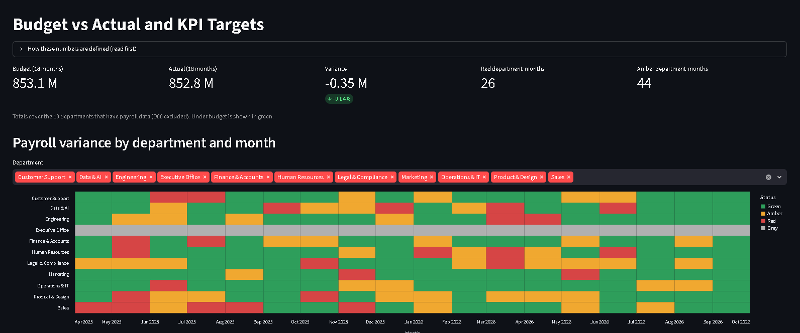
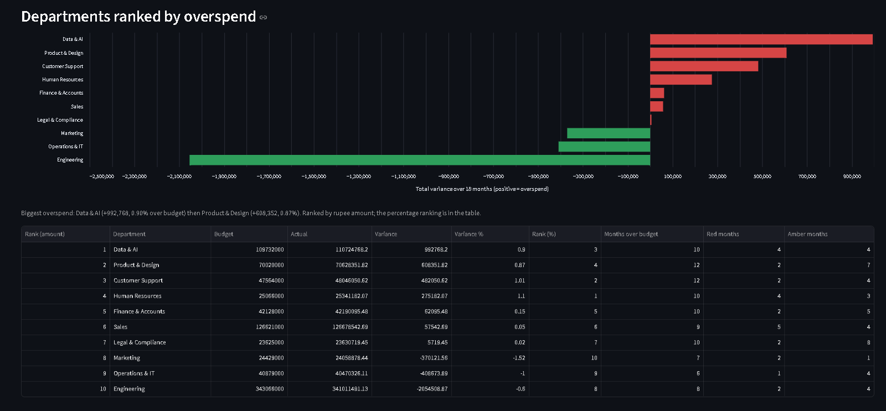
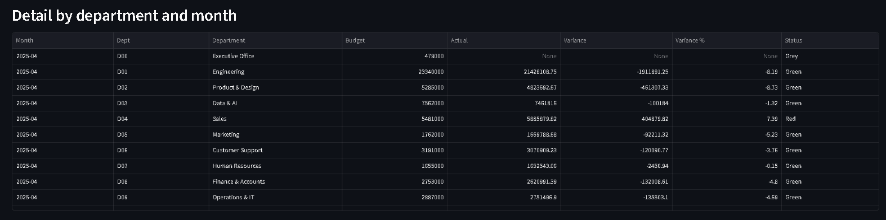
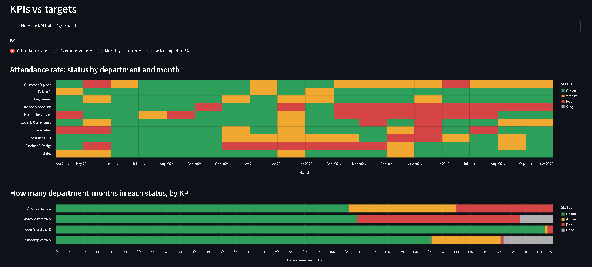
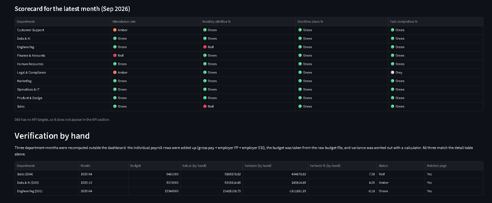
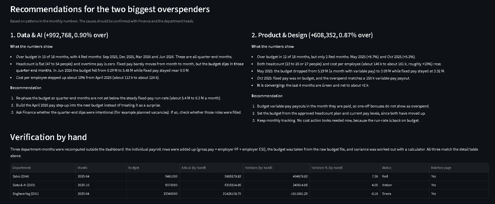
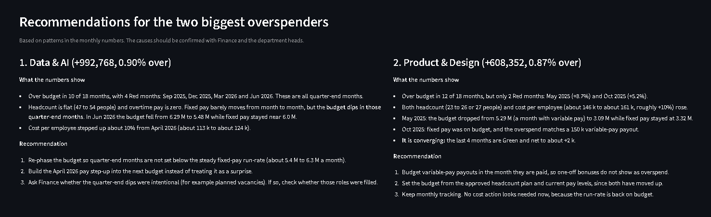

## Phase 3: Money and insight :

**What I built:** a P&L page with a month selector (`app/pages/PnL_Expenses.py`) on top of views in the `metrics` schema (`src/build_views.py`): revenue, expenses, net profit and margin by month, expenses by category, and the top 10 vendors.

**How accounts are treated:** `dim_account` marks 5 rows as groups (`is_group = 'Y'`): 1000 Assets, 2000 Liabilities, 3000 Equity, 4000 Income and 5000 Expenses. The P&L only uses detail accounts (24 on the Profit & Loss statement), so a group and its children are never counted together. No ledger lines are posted to group accounts, but the views exclude them anyway as a safeguard.

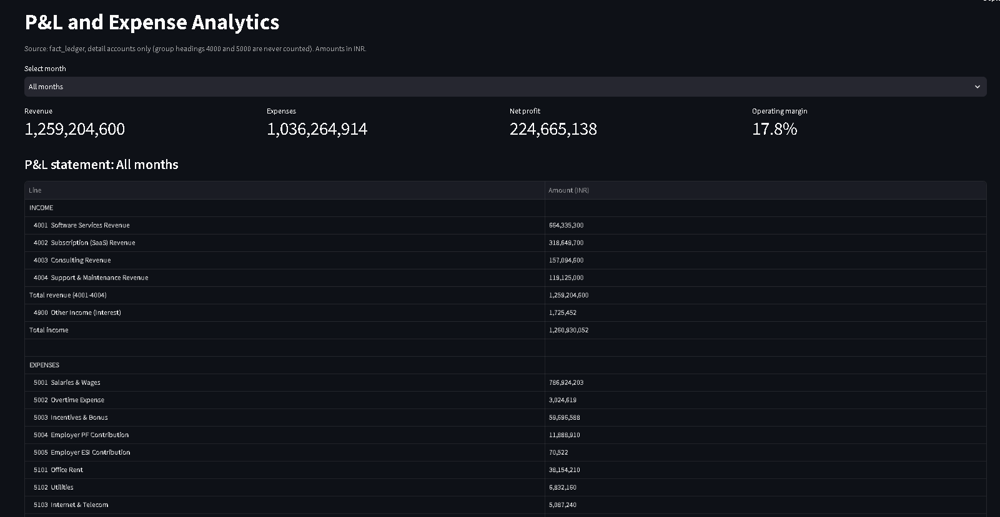
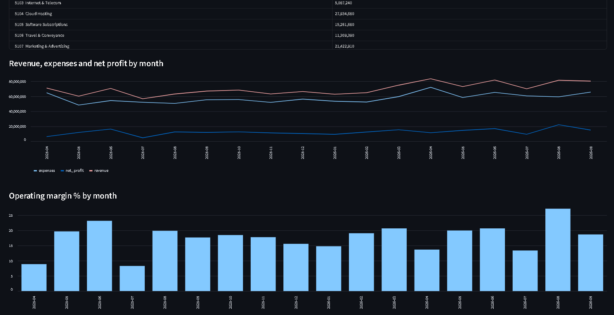
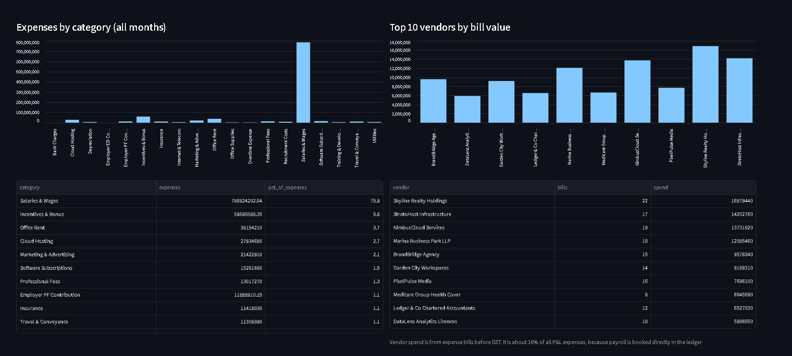
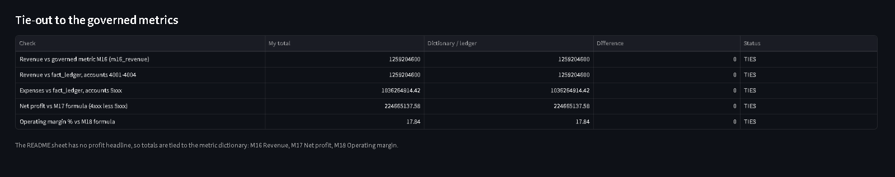
### Tie-out table

The README sheet has no profit headline (it only lists row counts), so I tied my totals to the governed metrics in the metric dictionary (M16 Revenue, M17 Net profit, M18 Operating margin) and to `fact_ledger` calculated independently.

| Check | My total | Dictionary / ledger | Difference | Status |
|---|---|---|---|---|
| Revenue vs M16 (`m16_revenue`) | 1,259,204,600 | 1,259,204,600 | 0 | TIES |
| Revenue vs fact_ledger, accounts 4001-4004 | 1,259,204,600 | 1,259,204,600 | 0 | TIES |
| Expenses vs fact_ledger, accounts 5xxx | 1,036,264,914 | 1,036,264,914 | 0 | TIES |
| Net profit vs M17 formula | 224,665,138 | 224,665,138 | 0 | TIES |
| Operating margin % vs M18 formula | 17.84 | 17.84 | 0 | TIES |

Revenue also matches `m16_revenue` in all 18 months, and expense bills match the ledger on all 12 bill accounts.

### Findings

1. **Margin swings a lot from month to month.** Over the 18 months the operating margin is 17.8%, but Aug 2026 reached 27.2% while Jul 2025 (8.3%) and Apr 2025 (8.9%) were the weakest. Jul 2025 also had the lowest revenue of the 18 months (56.8M), so expenses of 52.1M took most of it.
2. **People cost drives the cost base.** Salaries & Wages are 75.9% of all expenses, and with Incentives & Bonus (5.8%) people cost is over 80%. Office Rent is third at 3.7%, so margin depends mainly on payroll growth versus revenue growth.
3. **Vendor spend is concentrated.** The top 3 vendors are 26.6% of bill value and the top 10 are 60.9%. Skyline Realty Holdings (16.9M) is the largest, followed by two cloud vendors (StratoHost and NimbusCloud). 23 bills worth 9.9M are still unpaid. Vendor bills are only about 16% of P&L expenses, because payroll is booked directly in the ledger.

## Task 12: Receivables and cash

**Open invoices:** only SENT, OVERDUE and PARTIALLY_PAID are open (62 invoices, 139,394,278 total). DRAFT, CANCELLED and PAID are not open; their balance of 1,028,624 is excluded.

**Ageing:** days past due at the data cutoff, in buckets 0-30, 31-60, 61-90 and 90+ (not-yet-due invoices sit in 0-30). The 31-60 bucket is empty.

**Check:** the 4 buckets add up to 139,394,278 and match the direct total from fact_invoice (TIES). Overdue across all open invoices (27,110,866) matches metrics.m21. Status OVERDUE alone is 26,140,954; the 969,912 difference is the one PARTIALLY_PAID invoice, which is past due but not labelled OVERDUE. 
Hand check: INV-00691 (PARTIALLY_PAID) has total 1,701,600 minus paid 731,688 = 969,912, which equals its balance due. It is 7 days past due, so it sits in the 0-30 bucket.

**Cash:** cash in = payments received; cash out = monthly expenses from the P&L views (no separate payments-out ledger was used).

**Findings:**
1. 96.4% of open receivables (134.4M) is in 0-30. Only 3 invoices are more than 60 days past due (4.98M).
2. The slowest payers are Triveni Steel Industries (121.3 days on average) and Siruvani Agro Tech (105.4 days). Both also have overdue balances.
3. Marina Media Works owes the most overdue money (7.11M on 2 invoices), followed by Siruvani Agro Tech (6.10M on 3 invoices). Together they are about half of the 26.1M overdue.
4. Cash in exceeded cash out in most months. April 2025 was negative (net -9.31M).

### Screenshots

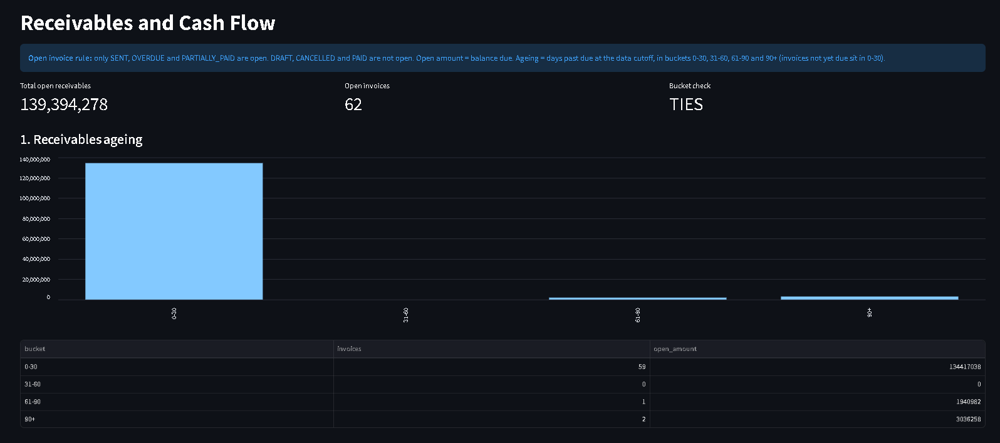
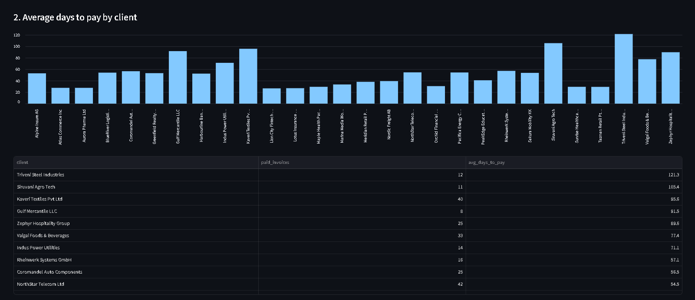
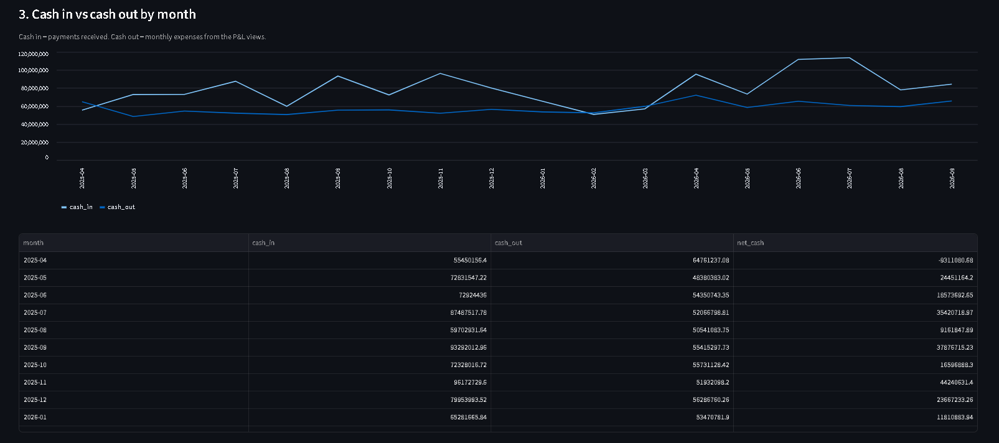
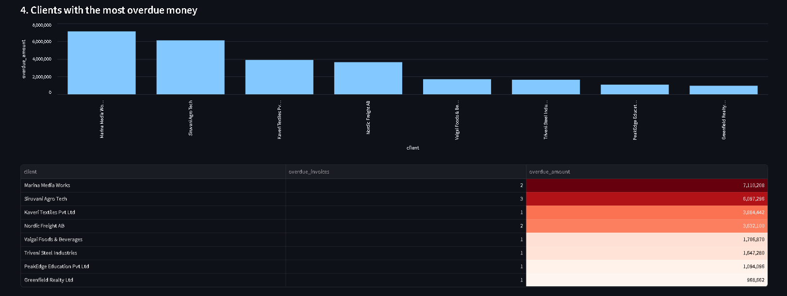
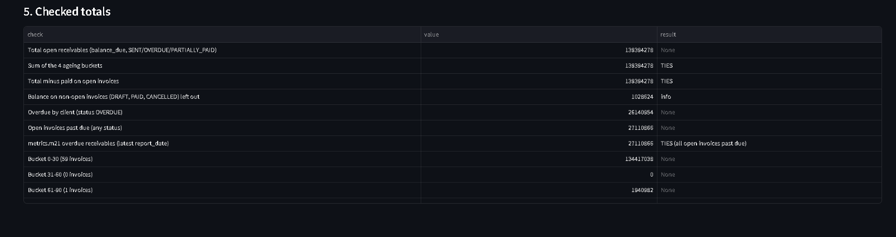

## Task 13: Cross-department impact view

**Grain:** one row per department and month (198 rows: 11 departments x 18 months, Apr 2025 to Sep 2026). Headcount (month-end, warehouse), payroll (v_payroll_valid: employer cost and overtime pay), attendance (fact_attendance_monthly), leave (v_leave_monthly) and exits (m03) are each aggregated to that grain first, then joined (`metrics.v_dept_month_impact`). Added overtime cost, overtime % of cost and leave days per head.

**Safety checks:** no duplicate department-months; each total in the combined view equals its source total (payroll 861,586,392.42; overtime 3,024,619.28; present days 141,139; leave days 7,342; exits 87; headcount 7,253).

**Comparison with reference_summary_dept_month:** all 198 department-months match on headcount, payroll cost, gross pay, overtime pay, overtime %, overtime hours, exits, attrition and attendance rate. Attendance rate first differed in 149 rows because my formula ignored half days; the reference counts a half day as half a day present, so I changed the formula and it now matches all 198 rows. The reference excludes the 4 invalid payroll rows (410,967.46), as my pipeline does. The reference has no leave columns, so leave days are checked against their source. Details are in docs/pq13_difference_notes.md.

**Findings:**
1. Engineering has the highest payroll cost (341.0M, about 40% of 861.6M), no overtime pay, and attrition of 22.4% over the period.
2. Operations & IT has the highest attrition (36.6%, 10 exits) and the second-highest overtime (825,356).
3. Overtime is paid in only four departments (Customer Support 1.29M, Operations & IT 825K, Human Resources 488K, Finance 420K). Cost and attrition do not move together.
4. Attrition is for the whole 18 months, not annualised.

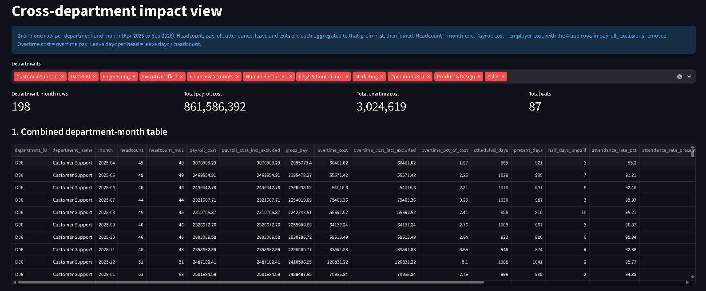
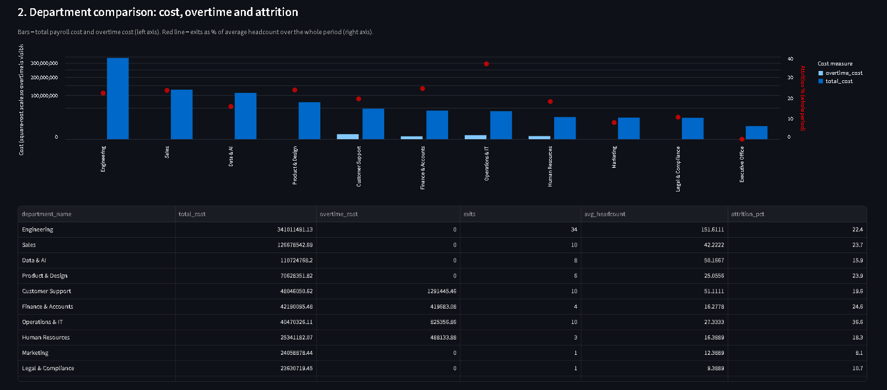
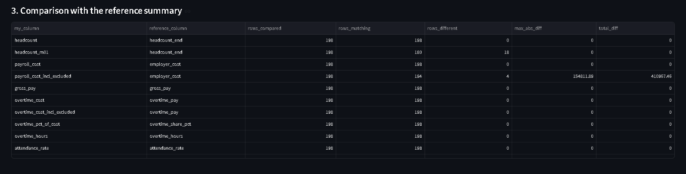

## Task 14: AI signals page

Page: `app/pages/AI_Signals.py`. Views: `src/build_ai_views.py`. Backtest: `src/build_ai_backtest.py`.
Every AI chart is labelled "AI-generated, for human review".

### Findings
- The AI flagged 405 records. 184 are payroll flags with an estimated Rs 31.42 million at risk. 221 are attendance flags with no rupee value (the data contract says money at risk is blank for attendance rows), so they are shown as counts only and never as zero.
- STATISTICAL_OUTLIER (Rs 19.43 million, 145 records) and GROSS_ABOVE_NORM (Rs 9.42 million, 13 records) make up about 92% of the money at risk.
- The AI forecast covers Oct 2026 to Mar 2027 with an 80% range. Actual data ends in Sep 2026, so the published forecast has no months with known actuals yet and its error table is empty (shown honestly on the page).
- To still measure reliability, I ran my own backtest (trained through Mar 2026, forecast Apr to Sep 2026). Headcount error (MAPE) was 1.97%, average miss 8.2 people, and the actual fell inside the 80% range in 6 of 6 months. Attrition was off by 0.54 percentage points a month on average.

### Caveats
- The backtest is my own approximation of the method, not the AI's published forecast.
- Six months is a small test.
- The first forecast month (426.3) starts below the last actual (441), because the simple trend model does not follow the recent jump.
- The forecast company total ("ALL") is matched to the sum of all departments. D00 is the 1-person Executive department, not the company total.

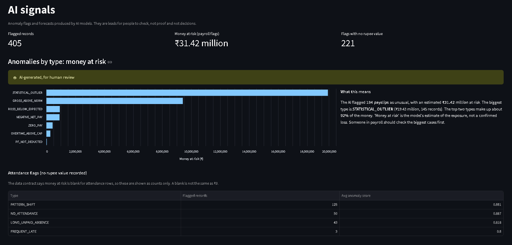
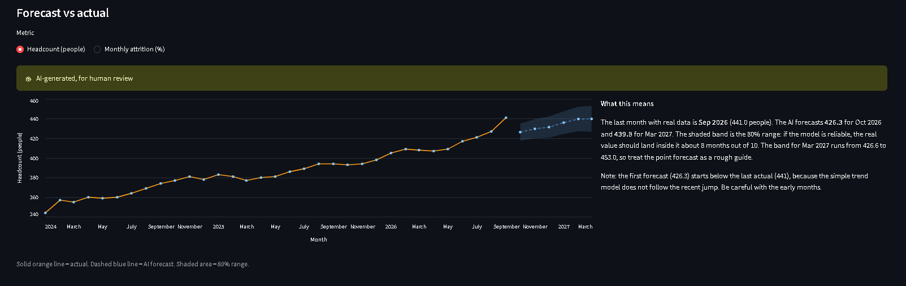
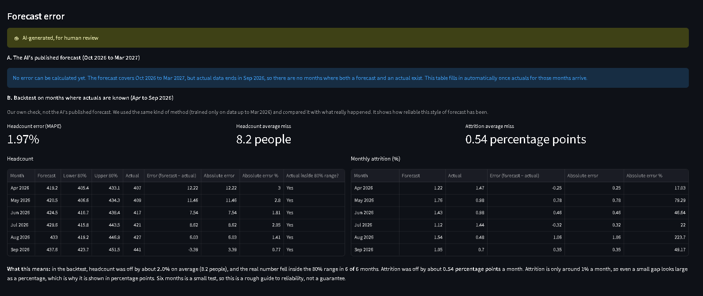

Forecast error table (backtest): `docs/forecast_error_backtest.csv`

## Task 15: Executive company-health scorecard

Page: `app/pages/Scorecard.py`. View: `src/build_scorecard.py` creates `metrics.v_scorecard` (8 KPIs x 18 months). Every value comes from the metric views (m01 to m22). Month selector, traffic-light status, trend, target and a link to the detail page on every tile. Prints on one A4 sheet (Ctrl+P).

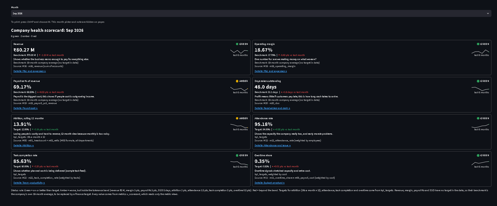

KPI list with reasons: `docs/scorecard_kpi_list.md`. Print version: `docs/Scorecard_Sep2026.pdf`.

### Findings (Sep 2026)
- 6 green, 2 amber, 0 red. Amber: payroll as % of revenue (69.17% vs a 68.50% benchmark) and rolling 12-month attrition (13.91% vs a 12% target).
- Attrition is red in 17 of the 18 months, so it is the one KPI that is persistently off target. Task completion and overtime share are green in all 18 months.
- Operating margin fell from 27.16% in Aug to 18.67% in Sep while payroll as % of revenue rose from 60.64% to 69.17%.

### Caveats
- Revenue, margin, payroll % and DSO have no target in the data, so their benchmark is the company's own 18-month average, labelled on the page. It should be replaced by a finance target.
- The attrition target (12%) is the data's 1% monthly target x 12, my conversion.
- Company-level numbers combine departments: attrition uses the M05 formula over m01 and m03 for all departments, because m05 leaves out departments under 10 people (13.99% vs 13.91% in Sep). Attendance is weighted by employees and overtime by cost; both match the source tables to within 0.05 and 0.003 points.
- Tolerance bands for amber are my judgement and are printed on the page. The task feed is a sample, per the metric dictionary.

## Phase 3 – Monthly Reporting

PulseIQ generates a monthly Excel reporting pack containing five sections:

1. **Headcount** – workforce headcount trends.
2. **Attrition** – employee attrition metrics.
3. **Payroll Cost** – monthly payroll cost analysis.
4. **Profit and Loss** – financial performance.
5. **Attendance** – employee attendance metrics.

### Generate a Monthly Report

Run these commands from the `phase-3` directory.

Create and activate a virtual environment:

```powershell
python -m venv venv
.\venv\Scripts\Activate.ps1