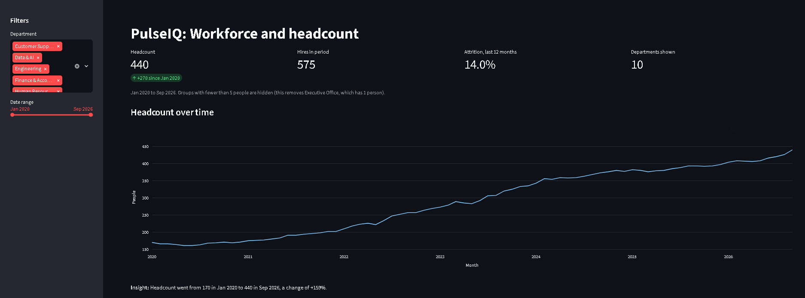
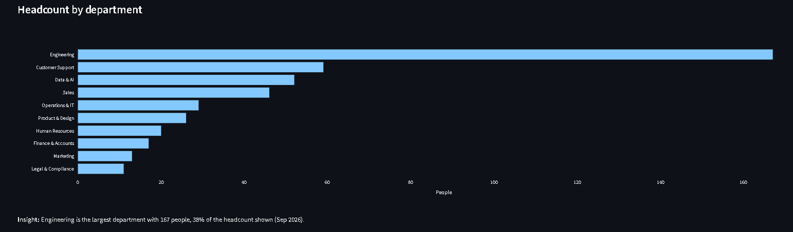
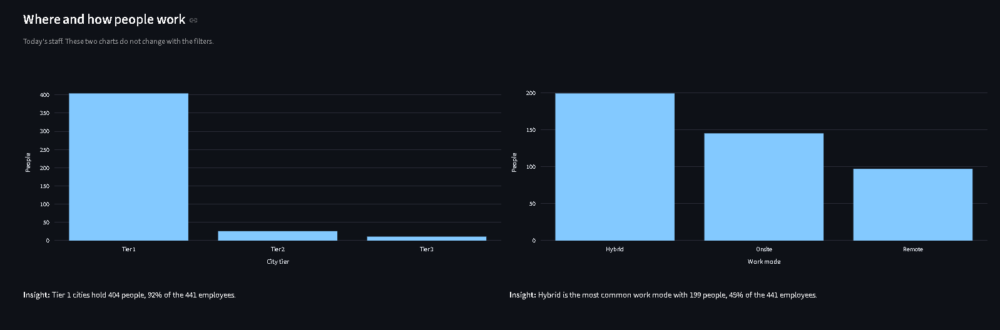
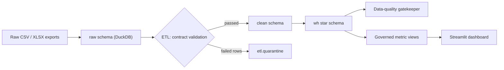
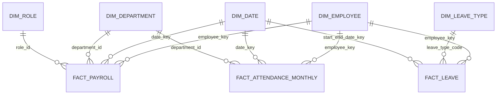
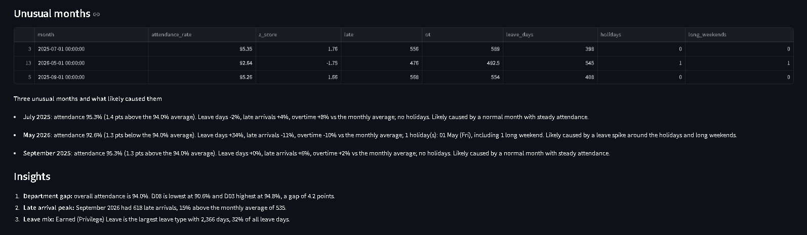

# PulseIQ Analytics

PulseIQ is a trusted people-analytics warehouse and dashboard (part of Aura Workforce). 
It loads the raw HR and finance exports through a repeatable pipeline that validates every column
against its data contract, builds a star-schema warehouse, runs a
data-quality gate on every load, and serves governed metrics to a workforce
and headcount dashboard. It is for HR leaders and analysts who need
workforce numbers they can trust.

**Author:** Shaikh Naved, Data Analysts track. Tasks PQ-01 to PQ-05 (Phase 1).

## Live demo
The dashboard runs locally (see "Run it locally" below), then opens at
http://localhost:8501. Screenshots of the dashboard, the data-quality report
and the pipeline run are in the report PDF and in the `docs/` folder.

## Features
- **ETL with data contracts (PQ-01):** validates 29 tables column by column.
  Rows that break a contract go to a quarantine table with the reason.
- **Star-schema warehouse (PQ-02):** 23 dimension and fact tables. Facts join
  history through `employee_key` (slowly changing dimension).
- **Data-quality gatekeeper (PQ-03):** 14 checks run on every load and write a
  report. The gate blocks when a critical check fails.
- **Governed metric layer (PQ-04):** official metrics as reusable SQL views
  with the minimum-group-size privacy rule.
-- **Workforce and headcount dashboard (PQ-05):** KPI tiles, headcount trend, headcount by department, city tier and work mode, with department and date filters.
## Tech stack
Python 3.12, pandas, pandera, DuckDB, SQL, Streamlit, Git/GitHub.

## Run it locally
1. Clone the repository: `git clone https://github.com/shaikhnaved-coder/pulseiq.git` then `cd pulseiq`
2. Create a virtual environment: `python -m venv venv`
3. Activate it (Windows PowerShell): `venv\Scripts\Activate.ps1`
4. Install the packages: `pip install -r requirements.txt`
5. Download the dataset from https://docs.google.com/spreadsheets/d/1tbSD2iIPvjEmTrHYHPwDamDIhxramBvM and place it in `03_Data/`
6. Load the raw data: `cd 05_Starter` then `python load_to_duckdb.py`
7. Run the ETL (still in `05_Starter`): `python etl.py`, then `cd ..`
8. Build the warehouse: `python src\warehouse.py`
9. Run the data-quality gate: `python src\gatekeeper.py`
10. Create the metric views: `python src\run_sql.py`
11. Start the dashboard: `streamlit run app\app.py` (opens at http://localhost:8501)

## Architecture

Pipeline:

Star schema (payroll, attendance and leave). Facts join to `dim_employee`
through `employee_key` (slowly changing dimension):

The full diagrams for every fact table are in [docs/star_schema.md](docs/star_schema.md).

## How I verified it works
- **Idempotent ETL:** two runs gave the same result: 29 tables, 62,770 rows in,
  62,737 passed, 33 quarantined, fingerprint `5249d226e200`. In = passed +
  quarantined for every table.
- **Quarantine:** attendance 4, attrition risk 5, payroll 4, task 20.
- **Warehouse reconciliation:** for the 23 warehouse tables,
  README = raw = quarantined + passed = clean = warehouse
  (61,904 rows, nothing lost). The other 6 tables (contracts, dictionaries,
  targets, payroll budget) are validated but are not warehouse tables.
- **Orphan check:** 0 broken keys on the employee, department, role, date,
  account, client, vendor, team and sprint keys. The rest are expected: 5,688
  ledger rows have no cost centre, 12 forecast rows use `ALL`, and 36 forecast
  rows fall after the end of the date table.
- **Data-quality gate:** 14 checks, 8 pass and 6 fail on the planted issues
  (2 critical), so the gate reports BLOCKED. This is correct for this dataset.
  Results were identical on repeat runs. `src\test_gatekeeper.py` runs 13
  tests on the checks themselves.
- **Planted issues:** `src\verifyplanted_issues.py` finds all 11 known issues
  (DQ-01 to DQ-11) in the data.

## Limitations and what I would do next
- Phase 1 only (PQ-01 to PQ-05). Later tasks are not built yet.
- The dashboard runs locally and is not deployed.
- DQ-C14 (minimum group size) flags 18 groups, and the dashboard hides small groups.
- No scheduler: the pipeline runs by hand.
- Next: containerise the pipeline, add CI to run the tests on every push,
  deploy the dashboard, and add the next dashboards.

  ## Attendance and leave findings 
  

- Department gap: overall attendance is 94.0%. D08 is lowest at 90.6% and D03 highest at 94.8%, a gap of 4.2 points.
- Late arrival peak: September 2026 had 618 late arrivals, 15% above the monthly average of 535.
- Leave mix: Earned (Privilege) Leave is the largest leave type with 2,366 days, 32% of all leave days.

# Three unusual months and what likely caused them

- July 2025: attendance 95.3% (1.4 pts above the 94.0% average). Leave days -2%, late arrivals +4%, overtime +8% vs the monthly average; no holidays. Likely caused by a normal month with steady attendance.
- May 2026: attendance 92.6% (1.3 pts below the 94.0% average). Leave days +34%, late arrivals -11%, overtime -10% vs the monthly average; 1 holiday(s): 01 May (Fri), including 1 long weekend. Likely caused by a leave spike around the holidays and long weekends.
- September 2025: attendance 95.3% (1.3 pts above the 94.0% average). Leave days +0%, late arrivals +6%, overtime +2% vs the monthly average; no holidays. Likely caused by a normal month with steady attendance.

